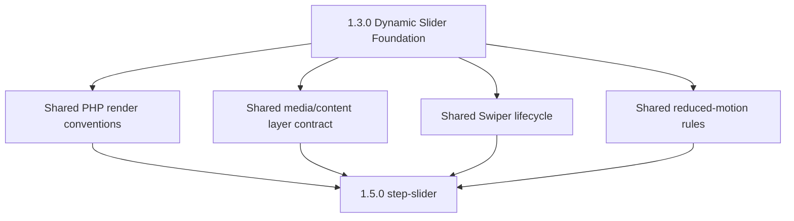
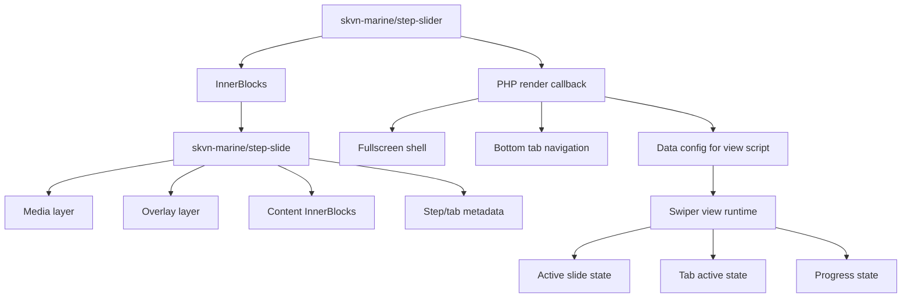

# V1 / 1.3.10 — Fullscreen Step Slider Planning

Status: PENDING — DEFERRED sang stack item **M5** (roadmap 039), chưa cấp SemVer mới.
Created: 2026-06-08
Current milestone: **V1 / 1.3.17** (xem `.context/MILESTONES.md`). Bản ghi này dùng 1.3.10 vì milestone `V1 / 1.3.10 — Fullscreen Step Slider` đã được đăng ký trong `AGENTS.md` §9; stack mapping `1.3.10 → M5` nằm ở `.context/planning/039_ROADMAP_C_B2B_TOOLKIT_CAROUSEL_FIRST_PLANNING.md`.

> Header cũ của file ghi `V1 / 1.5.0` và `Current milestone remains: V1 / 1.2.1`; cả hai dòng đã lỗi thời và được sửa ở đợt nghiên cứu 2026-10-14 (xem §14). Scope và acceptance của các mục 1–13 được giữ nguyên.
>
> **Không có SemVer nào được cấp cho M5.** Khi human đưa M5 vào triển khai, agent phải đề xuất SemVer theo `AGENTS.md` §0 và `MILESTONES.md` (`Milestone stack → SemVer`) rồi chờ human xác nhận.

## 1. Decision

Build Fullscreen Step Slider as a dedicated block family after the V1 / 1.3.0
dynamic Slider rendering foundation.

Target block names:

```text
skvn-marine/step-slider
skvn-marine/step-slide
```

This feature is not a fourth variation of the existing `skvn-marine/slider`.
Its interaction contract is different enough to deserve a separate block:
bottom tab navigation, per-step progress, sequential storytelling, and
process/timeline semantics.

## 2. Relationship To 1.3.0

V1 / 1.3.0 must establish the shared rendering foundation:

- Dynamic PHP rendering conventions.
- Media/overlay/content layer contract.
- Swiper ownership of interaction state.
- Reduced-motion and keyboard behavior.
- Conditional asset loading.
- Deploy artifact rules for plugin PHP runtime modules.

V1 / 1.5.0 consumes that foundation. It must not fork a second Slider render
engine or introduce a separate autoplay controller.



## 3. Architecture

Use Gutenberg-native child blocks:



Do not use the report's `slides: array`/`SlideRepeater` model for production.
That model would bypass Gutenberg List View, duplicate/reorder, nested content
editing, and existing editor governance decisions.

## 4. Layer Contract

Step slide frontend structure:

```html
<div class="skvn-step-slide swiper-slide">
  <div class="skvn-step-slide__media">
    
    <span class="skvn-step-slide__overlay" aria-hidden="true"></span>
  </div>

  <div class="skvn-step-slide__content">
    <!-- rendered InnerBlocks -->
  </div>
</div>
```

Step navigation is rendered by the parent `step-slider` from child slide
metadata:

```html
<div class="skvn-step-slider__tabs">
  <button class="skvn-step-slider__tab" data-skvn-step-index="0">
    <span class="skvn-step-slider__tab-number">01</span>
    <span class="skvn-step-slider__tab-label">Preparing the Land</span>
    <span class="skvn-step-slider__tab-progress" aria-hidden="true"></span>
  </button>
</div>
```

## 5. Attribute Ownership

Parent `step-slider` owns global behavior:

```text
autoplay
delay
loop
pauseOnHover
transitionPreset
heightPreset
tabPosition
showTabNumbers
```

Child `step-slide` owns per-step metadata:

```text
backgroundImageId
backgroundImageUrl
backgroundImageAlt
mediaType
backgroundVideoId
backgroundVideoUrl
overlayPreset
tabLabel
textPosition
kenBurns
```

Heading, paragraph, CTA, columns, and other editorial content remain
InnerBlocks. They must not become string attributes unless a later decision
proves InnerBlocks cannot support the required editing experience.

## 6. Runtime Ownership

Swiper owns:

- Active slide index.
- Touch/swipe.
- Keyboard navigation.
- Autoplay.
- Loop.
- Pause on hover where supported.

Step Slider view script owns:

- Reading Swiper events.
- Updating tab active state.
- Restarting CSS progress animation.
- Adding/removing motion classes for wipe/text cascade.
- Pausing progress when autoplay pauses.

Do not run a separate `setInterval` autoplay timer beside Swiper.

## 7. Governed Controls

Expose preset controls instead of raw arbitrary values.

Recommended controls:

```text
Height: viewport / tall / medium
Overlay: light / medium / strong
Text position: left / center / right
Motion: cinematic / gentle / none
CTA: primary / outline / text
Tab style: line / compact / numbers
```

Avoid in V1 / 1.5.0:

- Raw hex/rgb/hsl color input.
- Raw pixel font sizes.
- Raw transition milliseconds.
- Raw cascade delay.
- Raw class input.
- Icon picker unless separately approved.

## 8. Report Items To Keep

From `fullscreen-step-slider-report.md`, keep:

- Dynamic render direction.
- Fullscreen media/content composition.
- Bottom tab navigation.
- Per-tab progress bar concept.
- Wipe transition concept.
- Text cascade concept.
- Ken Burns as an optional governed motion preset.
- Conditional asset loading and lazy media strategy.

## 9. Report Items To Reject Or Defer

Reject for current architecture:

- `slides: array` data model.
- Custom `SlideRepeater`.
- Custom autoplay timer/controller.
- Raw user-controlled visual values.
- Static block rendering.

Defer unless explicitly scoped:

- Video background support.
- Top/left/right tab layouts beyond the first approved layout.
- Icon picker.
- Arbitrary color controls.
- Custom Swiper effect plugin.

## 10. Accessibility And Fallback Requirements

- Tabs must be buttons with clear accessible labels.
- Active tab state must be conveyed with `aria-current` or equivalent.
- Keyboard users must be able to navigate slides and tabs.
- Focus must not be trapped or lost after slide changes.
- Reduced-motion users must not receive autoplay-driven motion or wipe/cascade
  effects.
- No-JS fallback must leave all slide content readable.
- Mobile tabs must scroll or compact gracefully without text overlap.

## 11. Video Policy

Video is not automatically included in MVP. If approved, define:

- Muted, playsinline behavior.
- Poster image requirement.
- Pause inactive videos.
- Pause all videos when document is hidden.
- Mobile autoplay fallback.
- File-size/performance budget.

## 12. Testing

Editor:

- Insert Step Slider.
- Add, duplicate, remove, and reorder Step Slides through List View.
- Edit tab labels and background images.
- Confirm editor does not run frontend autoplay.

Frontend:

- Confirm tabs reflect slide order.
- Confirm tab click changes slide.
- Confirm autoplay updates active tab and progress.
- Confirm pause on hover/focus pauses progress.
- Confirm keyboard and touch work.
- Confirm reduced-motion disables forced motion.
- Confirm mobile tabs do not overflow text incoherently.

Deployment:

- Run plugin build.
- Run PHP syntax checks for new render files.
- Run deploy artifact audit if new PHP runtime paths are added.
- Confirm plugin zip includes the new runtime module.

## 13. Non-Goals

- No replacement of the base `skvn-marine/slider`.
- No custom slide manager.
- No `slides` array as production data model.
- No second Slider runtime.
- No GeneratePress parent theme changes.
- No raw Tailwind or arbitrary utility-class output.

## 14. Research inputs & project alignment (thêm 2026-10-14)

Phần này **bổ sung** cho scope ở §1–§13; không thay đổi scope, acceptance hay quyết định nào ở trên.

> **Lưu ý về đường dẫn:** `docs/ideations/` bị `.gitignore` loại trừ (mục `ideations`) — đây là cây nghiên cứu **local-only**, không phải tài liệu theo dõi bằng git. Link ở §14 chỉ resolve trên máy đang có cây nghiên cứu; phần **kết luận** phải được nhúng lại vào planning/decisions khi human chốt, không được để chỉ trong `docs/ideations/`.

### 14.1 Input trực tiếp — Step Slider

| Loại | Nguồn | Link |
|---|---|---|
| Chỉ mục nghiên cứu mẫu | Index nhánh From Soil to Harvest | `docs/ideations/sliders/from-soil-to-harvest/INDEX.md` |
| Báo cáo technical (scope deferred M5) | Kiến trúc, attribute schema, a11y, risk, test matrix, Q1–Q8 | `docs/ideations/sliders/from-soil-to-harvest/skvn-step-slider-technical-report-m5 .md` |
| Báo cáo planning Gutenberg | InnerBlocks/core blocks, quyết định kiến trúc, items còn mở | `docs/ideations/sliders/from-soil-to-harvest/skvn-step-slider-gutenberg-planning-report.md` |
| Prototype HTML | Autoplay + manual (Swiper 11.2.10, Tailwind CDN) | `docs/ideations/sliders/from-soil-to-harvest/artifacts/` |
| Đối chiếu contract | Các điểm chưa thống nhất + rule dự án | `docs/ideations/sliders/PROJECT_ALIGNMENT.md` |

Prototype là **HTML nghiên cứu**, không phải Gutenberg block. Số liệu QA headless (18/18, 13/13, 12/12) là claim trong báo cáo về prototype, **không** phải kiểm địng độc lập hay QA onsite; hiện không có file log kiểm chứng trong repo (`PROJECT_ALIGNMENT.md` `B-09`).

### 14.2 Input liên quan — Seafood (candidate so sánh, KHÔNG phải scope Step)

| Loại | Nguồn | Link |
|---|---|---|
| Chỉ mục nghiên cứu mẫu | Index nhánh Seafood Store | `docs/ideations/sliders/seafood-store/INDEX.md` |
| Phân tích mẫu | Composition split-screen, fish-trigger info panel, PREV/NEXT, không autoplay | `docs/ideations/sliders/seafood-store/seafood-store-slider-analysis.md` |
| Technical report clone | Bảo trùng prototype + 7 delta chưa khắc phục | `docs/ideations/sliders/seafood-store/seafood-clone-technical-report.md` |
| Gutenberg plan | Block candidate `skvn-marine/seafood-slider` / `seafood-slide` — **chưa phê duyệt đăng ký, ngoài scope Step** | `docs/ideations/sliders/seafood-store/skvn-seafood-slider-gutenberg-plan.md` |

Seafood chỉ được dùng để **so sánh interaction/composition** (info-panel mở thay nửa slide, split-screen 50/50, wrap bất đối xứng, không autoplay). Technical report của Step đã map những khác biệt này sang **scope B (deferred)** ở F13–F18. Đưa Seafood vào scope M5 là quyết định của human, không phải kết luận của nghiên cứu.

### 14.3 Bảng truy vết feature/decision → nguồn → trạng thái → conflict → điều kiện triển khai

| Feature/decision (§) | Nguồn nghiên cứu | Trạng thái | Conflict ID | Điều kiện để triển khai |
|---|---|---|---|---|
| Dynamic PHP render parent/child (§3, §9) | Technical report §3.3; planning report item 14 | Repo dùng mô hình **hybrid**: `save.tsx` trả markup có `<InnerBlocks.Content />` + `render_callback` PHP. `save: null` như research đề xuất sẽ **mất nội dung biên tập**. Item 14 **chưa nêu rõ** có còn `render_callback` không | `A-03`, `A-07`, `B-02` | `save.tsx` phải có `<InnerBlocks.Content />`; xác nhận ý định item 14; copy pattern `src/slider/save.tsx` + `modules/slider-render/slider-render.php` |
| Child block `skvn-marine/step-slide` (§1, §5) | Technical report §3.2 | Đã chốt trong planning | `B-01` | Làm rõ "1 block" = một parent có `mode` |
| InnerBlocks content (heading/paragraph/buttons) (§4, §12) | Planning report §3 | Đồng thuận | — | Dùng core blocks, không text attribute |
| Governed controls, preset không raw (§7) | Technical report §3.2 | Đồng thuận về nguyên tắc | `B-06` (tên preset height/overlay), `B-04` (delay) | Chốt một bộ tên preset + bộ duration Step |
| Slide count add/remove/reorder (§12) | Planning report preset 3/4/5; Seafood plan 3–8 | **Mâu thuẫn** | `B-03` | Human chốt preset-khởi-tạo vs giới hạn; tránh mất nội dung |
| Shared pause coordinator / reduced motion (§6) | Technical report §3.5, S2 | Repo đã có `src/shared/autoplay.ts` + `motion.ts` | `A-01`, `C-02` | Dùng shared có sẵn; không tạo runtime thứ hai |
| Swiper là owner state/timing (§2, §6) | Technical report §4 | Khớp lockfile 11.2.10 | `C-03` | Import từ npm `swiper`; không vendor bản thứ hai |
| Pause on hover/focus/hidden (§5, §6) | Technical report F7 | Khác cách diễn đạt | `B-05` | Chốt `pauseOnHover` đi qua coordinator |
| CSS width owner, no 100vw/overflow-x (§4) | Technical report §6 | Đã tuân thủ contract | — | Dùng `alignfull` + `100svh` |
| Theme opt-in header offset (§6) | Technical report §6 (CSS var) | Đúng; seafood analysis dùng selector | `A-02`, `C-05` | CSS var là hướng gọn nhất; selector chỉ chấp nhận ở dạng **tùy chọn có fallback**, tuyệt đối không gắn cứng selector theme |
| Editor preview tĩnh (§12) | Technical report R11 | Chấp nhận rủi ro thấp, chưa audit | `A-05` | Audit CSS editor theo A6 (không `opacity: 0` không fallback) |
| A11y tabs/aria-current/keyboard/no-JS (§10) | Technical report §5 | Đồng thuận; 2 câu hỏi mở | `C-04` | Test `inert` + Swiper A11y module trên loop clone |
| Tab label `tabLabel` string attribute (§5) | Planning report §3 | Đề xuất hợp lý, chưa có prototype editor | `D-04` | Human chọn inline RichText vs sidebar |
| Progress từ `autoplayTimeLeft` (§6) | Technical report §4.3 | Đã verify trên source Swiper 11 | `C-03` | Prototype Q2 (manual nav có restart delay không) |
| Metadata vs editorial content (§5) | Seafood plan specs list/repeater | Chưa có rule viết rõ | `A-06`, `D-03` | Human chốt rule; specs là content hay metadata |
| Menu 2 trạng thái của theme | Seafood plan §6 | Ngoài scope Step | `B-08` | Thuộc M4 sau M3; không gắn tên block |

### 14.4 Lựa chọn chưa thống nhất trước handoff

**A. Cần human chốt với memo 7 mục** (`docs/ideations/sliders/PROJECT_ALIGNMENT.md` §F):

1. **Phạm vi M5 + SemVer** (`F-1`, liên quan `B-07`).
2. **Xử lý khi giảm số slide** (`F-2`) — hạ preset xóa nội dung InnerBlocks là hậu quả **không đảo ngược**. Phần "giới hạn bao nhiêu" là quyết định đảo ngược được và tách riêng trong memo.

**B. Lựa chọn sản phẩm — cần human xác nhận, không cần memo dài** (`F-4`):

3. Bộ thời lượng autoplay của Step (`B-04`, `D-06`). Rule chung đã rõ: governed preset, không raw ms. Giá trị + default là lựa chọn trải nghiệm đọc.
4. Cách biên tập tab label: inline RichText trên tab bar hay sidebar (`D-04`). Ảnh hưởng tốc độ làm việc của marketing editor.
5. Phân định metadata attribute vs editorial InnerBlocks (`D-03`, `A-06`) — quyết định mô hình dữ liệu, cần chốt trước khi đóng contract block.

**C. Tiền đề kỹ thuật — agent tự xử lý và ghi lại** (`F-3`):

6. `A-07` — `save.tsx` phải có `<InnerBlocks.Content />`; sửa wording trong 2 tài liệu nghiên cứu + thêm case reload vào acceptance S1.
7. `A-03` — xác nhận ý định của item 14: còn `render_callback` PHP hay không. Nếu còn → tương thích contract; nếu bỏ → trái `018` §9 và decision 1.3.0 §4.
8. `A-01`/`D-02` — dùng `src/shared/*` hiện có; `carousel-factory` chỉ khi có ≥2 consumer đã audit.
9. `B-09` — không nâng trạng thái POC PASS; bổ sung log test ở lượt sau.

**Mọi đề xuất mặc định trong `F-2` và `F-4` đều là đề xuất chưa áp dụng** — không ghi đè lựa chọn đã ghi trong tài liệu nghiên cứu, và không tự hành xử khi implement.

Về `Q1`–`Q8` trong technical report: `Q1` **đã tách làm hai phần** sau review human 2026-10-14 (xem `PROJECT_ALIGNMENT.md` `C-01` và `A-07`) — phần render path đã có tiền lệ trong repo, phần lưu InnerBlocks thì `save: null` là **sai** và phải dùng `<InnerBlocks.Content />`. Các câu hỏi còn lại vẫn UNKNOWN, cần prototype/test.
